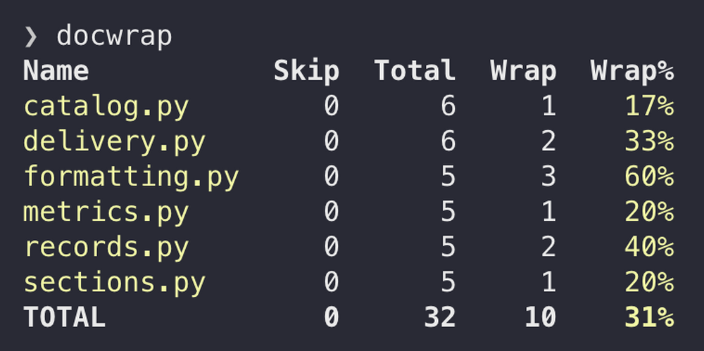
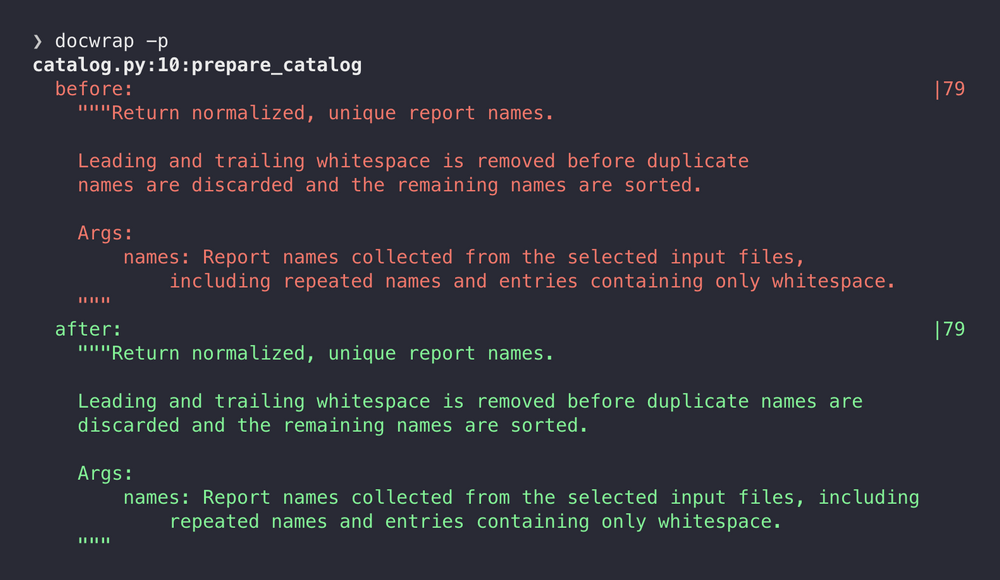

# docwrap

docwrap applies configurable formatting rules to Python docstrings. It makes wrapping and layout
deterministic, with controls for line length, paragraph reflow, and summary placement. It supports
Google, NumPy, and Sphinx/reST conventions.

Run `docwrap` to see which docstrings would change across your project:



Then use `docwrap --preview` to compare the original and proposed formatting. For example, using
the default 79-column limit:



## Installation

docwrap requires CPython 3.13 or later. From a checkout, install the command with
[uv](https://docs.astral.sh/uv/):

```bash
uv tool install .
```

To update an existing installation after pulling changes:

```bash
uv tool install --reinstall .
```

Git is needed for agent hooks and incremental mode; uv is needed for these installation commands,
not at runtime.

## Quick start

Start with a summary, preview individual docstrings, inspect the diff, then apply the changes:

```bash
docwrap
docwrap --preview
docwrap --diff
docwrap --write
```

Paths default to the current directory. Pass a file or directory to limit the scope.

Use `docwrap --stats` to inspect line-length distributions, compare wrapping targets, and see
recommendations.

Without `--write`, docwrap leaves files alone. It exits 0 when no changes are pending or a write
succeeds, 1 when changes are pending, and 2 on an error. Start with the defaults: 79 columns,
`smart` filling, cautious reflow, and no summary wrapping. To change the width for a project, add:

```toml
[tool.docwrap]
line-length = 88
```

Configuration is discovered from each file's `pyproject.toml`. The
[wrapping policy guide](docs/design.md#choosing-a-wrapping-policy) explains the tradeoffs between
reflowing prose and preserving authored layout. See the [CLI reference](docs/cli.md) for output
modes, configuration precedence, and advanced options.

## Integrations and library use

A local [pre-commit](https://pre-commit.com/) hook can run docwrap when you commit. See the
[pre-commit setup](docs/hook.md#pre-commit) for a writing hook and its report-only variant. Agent
hooks for Claude Code, Codex, and Antigravity can run before commits or after edits. Their
installation, host settings, commit behavior, and composition limits are in the
[agent hook guide](docs/hook.md).

For Python callers, `wrap_source()` returns rewritten source, `check()` reports whether it would
change, and `wrap_source_report()` supplies structured results:

```python
import docwrap

source = 'def greet():\n    """Return a greeting."""\n'
result = docwrap.check(source)
wrapped = docwrap.wrap_source(source)
```

See the [library reference](docs/library.md) for file operations, configuration, result types, and
safety skips.

## Documentation

| If you want to...                                      | Read                                       |
| ------------------------------------------------------ | ------------------------------------------ |
| Look up commands, output, configuration, or exit codes | [CLI reference](docs/cli.md)               |
| Set up agent hooks, commit handling, or host responses | [Agent hook guide](docs/hook.md)           |
| Wrap only changed files or definitions                 | [Incremental mode](docs/incremental.md)    |
| Call docwrap from Python                               | [Library reference](docs/library.md)       |
| Choose a style and understand what docwrap preserves   | [Concepts and safety](docs/design.md)      |
| Check supported environments and file behavior         | [Platform compatibility](docs/platform.md) |

## Development

See the [development guide](docs/development.md) for pinned CI dependencies and lock updates.

From the checkout, run `make check` for repository checks. Run `make format` to apply the
repository's formatters. The Makefile also provides `make install`, `make reinstall`, and
`make test`; install targets use uv.

## License

docwrap is available under the [MIT License](LICENSE).
